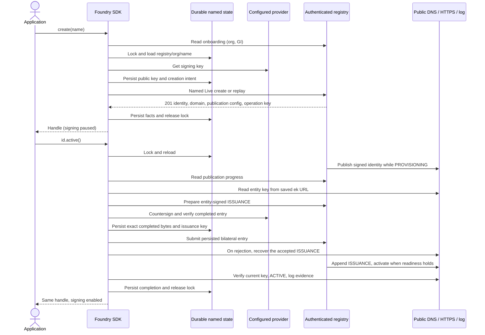

# Known Foundry Server Requirements

Server behavior that [Foundry create/active](sdk-design/13-known-foundry.md)
depends on. The server contract belongs to
[E2](https://github.com/Identity-Digital/known-foundry/issues/2) and its SCEN, SPEC,
and TEST artifacts. This document records what the SDK assumes and what is still
open. It is not a server specification and does not claim deployed support.

## Contract and Ownership

The [server registration contract](https://github.com/Identity-Digital/dnsid/pull/3554)
and [SDK workflow](sdk-design/05-transport-and-registry.md#registration-and-issuance)
define publication, bilateral ISSUANCE, activation, deadlines, and recovery.

E1 supplies domains, E2 owns admission and recovery, E4 owns credentials, E5 owns
the SDK and CLI, E6 owns key providers, E7 owns rotation, E8 owns terminal serving.
Named creation uses the direct Live registration workflow. The SDK does not
select a domain or choose a fallback.

## Registration Evidence

Source review dated 2026-11-12; no hosted acceptance run or deployed support is
claimed. [PR #3554](https://github.com/Identity-Digital/dnsid/pull/3554) is open at
reviewed revision `0e4871e82b824f81a58b59c79d690103dec71d43`.

| Requirement | Evidence / release status |
|---|---|
| SR-1 onboarding authorization | `internal/api/server.go:1570–1582` permits organization-member reads; `org_onboarding_handler_test.go:82–116` covers admin/member sessions. `apikey_handlers.go:263–272` and `middleware.go:299–311` support API-key-authenticated context when enabled. Source-checked; dedicated org-API-key onboarding acceptance remains unverified. |
| SR-5 creation/replay wire response | `internal/api/agent_create_live.go` returns HTTP 201 with identity ID, assigned domain, registry status, publication configuration, issuer, and response Idempotency-Key. Wire shape is source-checked, not hosted acceptance. |
| SR-7 publication prerequisite | `internal/api/agent_handlers.go:146,358` emits boolean `dns_published` from `DNSIDPublished`; `internal/identitypublish/publish.go:128` sets it after signed publication, and `internal/api/tlog_handlers.go:100–103` gates preparation during PROVISIONING. Source-checked; hosted acceptance remains required. |
| SR-4 terminal name retention | Not established at the reviewed revision. Retention across revoke, retire, and soft deletion remains a release gate; no fix is claimed. |
| SR-4/SR-5 durable named replay | Not established beyond replay-cache retention or after rotation. [#45](https://github.com/Identity-Digital/known-foundry/issues/45), [#47](https://github.com/Identity-Digital/known-foundry/issues/47), and [#48](https://github.com/Identity-Digital/known-foundry/issues/48) require E2 acceptance evidence before enablement. |

## Workflow Overview

The server must continue accepted work without another client request, but it
cannot produce the customer countersignature. That step waits for the client.

## Account Binding Discovery

The SDK uses `GET /api/v1/org/onboarding` for `org_id`, GI, and entity delegation
under [05](sdk-design/05-transport-and-registry.md#account-binding-discovery). The
entity key URL comes from `publication_config.ek_url`. The read accepts an
owning-organization session credential (admin or member) or organization API key
when enabled. [Registration Evidence](#registration-evidence) records source support;
org-API-key onboarding acceptance remains unverified.

There is no capability field for named registration. Until E2/E5 agree a version
or capability negotiation, release against a tested server revision and record it.

## Required Server Behavior

E2 SCENs are the wire authority. Foundry's named ownership and replay guarantees
are distinct from ordinary sandbox registration.

| ID | Required behavior | Status / gap |
|---|---|---|
| SR-1 | Authorize the organization; enforce verified-domain gates, tenant isolation, key validation, and quotas before effects. Do not expose other tenants' facts. | E2/E4, ABU-1. API-key authentication alone is not authorization. |
| SR-2 | Exact organization/name ownership, including pending rows. Matching concurrent requests return one identity. A different key fails without changing the identity or consuming a domain. | [PR #3150](https://github.com/Identity-Digital/dnsid/pull/3150). Further name policy needs server agreement. |
| SR-3 | Commit identity, domain reservation, and workflow handoff together. Publish the signed identity while PROVISIONING, then wait for accepted bilateral ISSUANCE. Recover unfinished server work without a client call. | E2 admission and durable workflow. Caller-key countersigning waits for the client. |
| SR-4 | Identity bindings outlive the replay cache. Delayed requests, cleanup, and terminal transitions never allocate a replacement or revive an old identity. | Unverified release gate; see [Registration Evidence](#registration-evidence). Terminal replacement requires SR-8. |
| SR-5 | Caller-key Live create and replay return HTTP 201 with `id`, `domain`, current registry `status`, `publication_config`, and `oidc_issuer_url` when the deployment has a per-tier issuer. The response Idempotency-Key equals the submitted key. A matching organization, name, and public key resolves to the same identity, including READY, so a replica without local state can resume. | Wire shape source-checked; named replay guarantees remain unverified. See [Registration Evidence](#registration-evidence). |
| SR-6 | Validate signatures before durably admitting submitted ISSUANCE bytes. An invalid signature does not consume the issuance key. Expose accepted-entry and preparation-reclaim facts. When an ISSUANCE is already accepted, reject a new preparation or different submitted bytes with a structured error; never accept a second ISSUANCE. The SDK relies on this rejection to find another replica's ISSUANCE. | [#46](https://github.com/Identity-Digital/known-foundry/issues/46). Different bytes under an accepted issuance key are rejected, not given its receipt. Open: whether `TLOG_INVALID_ENTRY` can be transient, and whether the same issuance key may prepare again after it; 11 never reclaims a preparation that entered submission. |
| SR-7 | Report registry progress, customer-action outcomes, structured errors, and publication fields (including `ek_url`). For registry-managed publication, authenticated agent detail includes required boolean `dns_published`: false while publication is pending, then true once signed publication completes during `PROVISIONING`, before ISSUANCE preparation. Activation requires an accepted bilateral entry and receipt matching the current identity, key, and GI, plus publication and applicable JWKS/TLS/serving readiness under the identity guard. | Wrong key is 409 `KEY_MISMATCH`; full error matrix belongs to E2. |
| SR-8 | Replacement after revoke or retire gets a new domain and log stream; the old identity stays terminal. Delayed old creates do not trigger it. | Not agreed; see the [proposal](#proposal-name-reuse-and-failed-provisioning). Separate gate. |

## Decisions Still Owned Outside the SDK Design

- **E2 [#45](https://github.com/Identity-Digital/known-foundry/issues/45) / [#47](https://github.com/Identity-Digital/known-foundry/issues/47):** Replacement intent, historical lookup, and the error matrix.
- **E2 [#46](https://github.com/Identity-Digital/known-foundry/issues/46):** Detailed provisioning error and staff-disposition policy, subject to the
  [registration recovery contract](sdk-design/05-transport-and-registry.md#registration-and-issuance).
- **E2 [#47](https://github.com/Identity-Digital/known-foundry/issues/47) / E5:** Compatibility negotiation.
- **Product / E2:** A Foundry-specific selector, only if Foundry and Live
  organizations need different rules in one deployment.
- **E2 / ABU-1:** Quota values, quota release, and failed-provisioning cleanup.
- **E4:** Credential scopes, expiry, renewal, and revocation.
- **E6:** Key provisioning, algorithms, multi-region setup, the one-identity-per-cloud
  model, and recovery of replicas that hold a different key.
- **E7 / E8:** Key and status hosting, rotation, terminal serving.

## Proposal: Name Reuse and Failed Provisioning

**Status:** Assumed by the SDK design; not yet agreed by E2. Record the agreed
outcome and SCEN links before enabling replacement.

Rules are per authenticated organization and exact name.

| Situation | Assumed server behavior |
|---|---|
| Provisioning fails or is unfinished | The name stays bound to the original attempt and key. A same-key retry resumes it. A different key gets `KEY_MISMATCH`. |
| Nonterminal identity; caller supplies the identity's current key after rotation | Return the existing identity with HTTP 201 and the caller's Idempotency-Key in the response header. Compare against the stored current operational key. Superseded-key lookup needs E2 agreement. |
| Nonterminal identity; caller supplies an unrelated key | `KEY_MISMATCH`; no change. |
| REVOKED or RETIRED; caller uses a key from that identity | Return the terminal identity with its ID, domain, and status; allocate nothing. |
| REVOKED or RETIRED; caller supplies a new, unused key | After SR-8 is enabled: create a fresh identity and domain, with no separate replacement API. Before SR-8: return a terminal error and allocate nothing. Open for E2: its HTTP status and code, and whether it carries the ID, domain, and status. |
| Delayed request with a key from an earlier identity | Resolve to that earlier identity, even after later replacements. |
| Replay cache expires or a row is soft-deleted | Neither permits replacement or revival. |

Example: A is created and retired; B replaces it and is retired. A delayed request
with A's key resolves to A. Competing replacement requests produce one new identity.

Open for E2: which failures can resume, how an attempt is abandoned, when a name or
domain is released, whether a new key is enough replacement intent, and how long
historical keys (including rotated keys) are retained for lookup.

## Acceptance Checks

Use real PostgreSQL and the shipped server, with Temporal and provider fixtures where
needed. Record server and SDK revisions.

- [ ] SR-1: tenant isolation, gates, and quotas hold independently of authentication;
  an org API key can read onboarding.
- [ ] SR-2/SR-3: concurrent matching creates yield one identity, domain, key, and
  handoff; conflicts change nothing.
- [ ] SR-3: interruption before or after commit recovers without a client call;
  completed work does not relaunch.
- [ ] SR-4: replay-cache expiry, restarts, lost responses, and deletion cause no
  reallocation or revival.
- [ ] SR-5: create and replay return 201 with the same identity, assigned domain,
  registry status, publication bindings, issuer when present, and response Idempotency-Key.
  A replica without saved state resumes bilateral ISSUANCE; after rotation it
  recovers the accepted genesis and checks continuity to the current key.
- [ ] SR-6: interrupted submissions reuse exact bytes; a competing
  signature is rejected and its replica recovers the accepted entry;
  invalid then valid submission succeeds.
- [ ] SR-7: authenticated registry-managed detail always includes boolean
  `dns_published`; it changes from false to true after signed publication during
  `PROVISIONING`, before ISSUANCE preparation. All error and customer-action cases
  return structured outcomes; public `ACTIVE` is checked separately from `READY`.
- [ ] SR-8 (separate gate): replacement and late retries keep terminal history and
  allocate exactly one new domain.
- [ ] E5: all SDK bindings and CLI pass the shared hosted scenarios.

Initial create needs SR-1 through SR-7 and refusal of terminal replacement: for a
REVOKED or RETIRED name, the server returns a terminal error for a new or unrelated
key, because the SDK cannot detect replacement for a replica without local state.
A key from that identity gets the terminal identity, as in the
[proposal](#proposal-name-reuse-and-failed-provisioning); the SDK reports it as a
typed terminal error. SR-8 enables replacement later.
