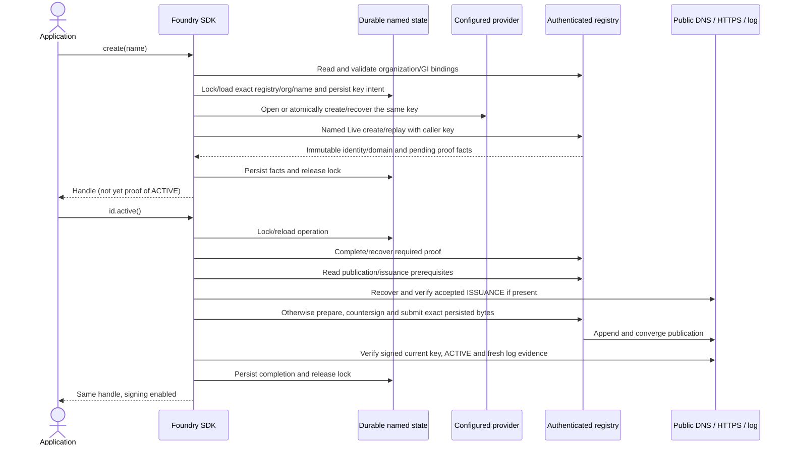

# Managed Registration Server Requirements

Server dependencies for [Foundry create/active](sdk-design/13-managed-registration.md)
and [named registration](sdk-design/05-transport-and-registry.md#named-managed-registration).
The server contract belongs to [E2](https://github.com/Identity-Digital/known-foundry/issues/2)
and its SCEN/SPEC/TEST artifacts; this document records SDK requirements and gaps,
not a second server specification or a claim of deployed support.

## Evidence and Ownership

Reviewed 2026-11-05:

| Source | Evidence / status |
|---|---|
| Server main `966e62ebbc87ad4ee88205c85ea505ce08edfe79` | Ordinary PostgreSQL replay rows expire after 24 hours. This is not sufficient for automatic named recovery. |
| [Server PR #3150](https://github.com/Identity-Digital/dnsid/pull/3150), `6c01536a603362140d426beac3f9a1186e88c7e2` | Open, unmerged. Named Live ownership starts with a pending Agent row; exact case-sensitive names; unique organization/name index; CANCELLED/REJECTED/ERROR retain ownership, while revoke/retire/soft deletion release the index slot. |
| [Server PR #3304](https://github.com/Identity-Digital/dnsid/pull/3304), `bd4a27a1d5b23767e4807944d10382bbba605897` | Open, unmerged. Caller-key Live SDK compatibility: HTTP 202 replay, caller Idempotency-Key as request_id, distinct 409 KEY_MISMATCH, and replay-cache-expiry tests. These are not integrated acceptance claims. |
| [#45](https://github.com/Identity-Digital/known-foundry/issues/45) | Atomic identity/domain assignment and durable handoff, including matching return-existing paths. |
| [#46](https://github.com/Identity-Digital/known-foundry/issues/46) | Durable proof/issuance workflow and recovery, without manufacturing a customer countersignature. |
| [#47](https://github.com/Identity-Digital/known-foundry/issues/47) | Create/readiness/error responses and operation/generation semantics. |
| [#48](https://github.com/Identity-Digital/known-foundry/issues/48) | Integrated interruption/concurrency proof. |

The current implementation direction reuses named Live/pool provisioning. The
SDK must not send ordinary selector-free registration and receive a sandbox agent.
E1 supplies inventory; E2 owns admission/assignment/recovery; E4 owns credentials;
E5 owns SDK/CLI composition; E6 owns provider discovery; E7 owns rotation; E8 owns
terminal serving. Pool-empty behavior is Live register-at-create fallback per the
E2 index, not an SDK-selected fallback. Several older issue paragraphs still list
it as open; confirm final SCENs rather than implementing both policies.

## Workflow Overview

Timeout/cancellation preserves progress, not rollback. Without a running client,
missing customer signatures may remain pending. Already accepted server work must
recover without another client request. New client invocations reopen the same key
and operation, never allocate a replacement because the previous result is unknown.

## Existing Account Binding Discovery

Use existing authenticated `GET /api/v1/org/onboarding` for `org_id`, GI/proof, and
entity delegation, under [05's validation](sdk-design/05-transport-and-registry.md#account-binding-discovery).
Compare configured/saved organization ID byte-exact before mutation. Onboarding
instructions are not an entity JWKS URL or new trust root; `entityKeyUrl` remains
configured. No new account-discovery endpoint is required.

There is no agreed `managed_registration` onboarding capability field. The SDK
hash domain separator is not evidence of server support. E2/E5 must agree capability
or version negotiation; until then release against an explicitly tested server
contract/deployment and record that compatibility. Do not enable this workflow
against an arbitrary registry or let an acknowledgement switch bypass acceptance.

## Required Server Work

These acceptance obligations are not all implemented or proven by the cited PRs.
Use the final E2 SCENs as wire authority; keep ordinary sandbox/zone registration
and its bounded replay contract separate.

| ID | Required behavior | Coordination / remaining gap |
|---|---|---|
| SR-1 | Authenticate and authorize the organization; enforce verified-domain gates, tenant isolation, public-key validation, and create quotas/rates before relevant effects. Reject conflicting account bindings without exposing foreign identity facts. | E2/E4 and ABU-1. API-key authentication alone does not prove authorization or scoped privilege. SDK-derived hashes are not credentials and need no new server hash-validation scheme. |
| SR-2 | Use exact organization/name ownership, including pending rows. Concurrent matching callers return one identity; different keys fail without changing identity/key/status or consuming another domain. | PR #3150 provides the ownership direction. No SDK-only NFC/trim rule. Additional name policy and existing collision migration require server agreement. |
| SR-3 | Commit identity/domain assignment and durable handoff consistently; recover unfinished absent/closed/failed workflows, including return-existing paths and no further client call. | #45/#46/#48; stable workflow ID alone is insufficient. Main's ordinary create/cache path does not establish this guarantee. |
| SR-4 | Retain durable operation/history bindings beyond replay-cache expiry. Delayed requests, deletion, cleanup and terminal transitions must not allocate unintended replacements or resurrect old identities. | #45/#47/#48. Permanent ordinary cache rows are not required; durable generation lookup/retention and soft-deletion behavior still need complete proof. |
| SR-5 | Preserve caller-key Live 202/proof semantics, request_id equal to the caller's Idempotency-Key, and immutable identity/domain facts needed for safe continuation. Reissue only reclaimable expired proof on the same key/operation. | PR #3304. A replay without challenge may omit its derived domain: the SDK can use saved state, but recovery from lost local state needs an agreed authenticated response/lookup. |
| SR-6 | Keep customer proof and ISSUANCE countersigning distinct. Validate identity/key/log/signatures before durable admission of submitted bytes; invalid signatures must not poison the issuance key. Expose accepted-entry and safe preparation-reclaim facts. | #46 plus existing prepared-event endpoints. Replicas with different valid signature bytes must recover one verified accepted ISSUANCE without a second append. |
| SR-7 | Expose accurate registry progress, customer-action outcomes, structured errors, and authoritative publication fields. Readiness requires issuance, log inclusion, and required publication, not workflow completion alone. | #47. Wrong supplied key uses the in-flight 409 KEY_MISMATCH meaning; missing key, revoked credentials/keys, and other conflicts remain distinct. Preserve existing ordinary and Live error codes. |
| SR-8 | Intentional replacement after revoke/retire gets a fresh domain/log stream, while old identity/domain/history remain terminal and assigned in V1. Delayed old creates cannot trigger it. | Generation/replacement intent is not finalized. This design adds no `replaces` field or endpoint. CANCELLED/REJECTED/ERROR and soft deletion are not blanket replacement authorization. Gate replacement separately. |

## Decisions Still Owned Outside the SDK Design

- **E2 #45/#47:** Generation/replacement intent and historical lookup, including
  replay-cache expiry, soft deletion, and delayed old requests. The final error
  and fingerprint matrix must distinguish changed input from wrong/missing keys.
- **E2 #46:** Whether the separate Live proof challenge remains; recovery/customer
  action when proof or a signature is missing; recoverable versus terminal
  provisioning outcomes. The E2 index retains the 48-hour issuance wait then ERROR
  safety bound; #46 notes that this is existing behavior, not final Foundry policy.
  Do not turn ERROR into name release or an SDK automatic restart.
- **E2 #47 / E5:** Final accepted/replay response and authenticated lookup when
  domain/publication facts are absent; machine-readable compatibility negotiation.
- **Product / E2:** A distinct Foundry selector is needed only if Foundry and Live
  organizations share a deployment with different rules. The current SDK adapter
  uses the Live route; do not invent a new tier without a server decision.
- **E2 / ABU-1:** Numeric quota/rate values, quota release, and failed-provisioning
  cleanup. Preserve pending ownership until an agreed outcome authorizes release.
- **E4 / security:** Setup credential scopes, expiry, and final revoked-key wire
  codes/remedies. Current expiring organization keys still carry broad privileges.
- **E6:** Atomic first-key discovery across replicas, algorithm/provider support,
  and same-cloud multi-region setup. A registration hash cannot solve a provider race.
- **E7/E8:** Key/status hosting locations, rotation cutover/retention, terminal
  serving, and revocation propagation. SDKs consume returned/signed URLs; no new
  key-specific path convention is required for E5 create enablement.

## Acceptance Checks

Use real PostgreSQL and shipped server assembly, plus Temporal/external-provider
fixtures where needed. In-memory handlers or green PR CI alone do not establish
integrated support. Record the server/SDK revisions and provider limits.

- [ ] SR-1: API-key create enforces tenant isolation, verified-domain gates and
  quota/rate limits independently of authentication; no foreign disclosure or writes.
- [ ] SR-2/SR-3: concurrent matching creates yield one durable identity, domain,
  key binding, and logical handoff; wrong-key/input conflicts mutate none of them.
- [ ] SR-3: interruption before/after commit and handoff, absent or failed workflow,
  and return-existing paths recover without another client call; completed work
  does not relaunch. Uncertain external outcomes are reconciled before repetition.
- [ ] SR-4: expire/sweep replay-cache rows, restart processes, lose responses, and
  delete/terminate identities without unintended reallocation or resurrection.
- [ ] SR-5: real caller-key SDK flow creates, replays, proves/reissues, restarts,
  and recovers immutable facts; request_id is not confused with internal operation ID.
- [ ] SR-6: interruptions at preparation/submission/acceptance boundaries reuse
  exact bytes. Competing valid countersignatures converge on one accepted entry;
  receipts never claim acceptance of the losing bytes. Invalid then valid submission
  under the same key succeeds; reclaimability cannot include uncertain commitment.
- [ ] SR-7: missing signatures, ERROR, CANCELLED/REJECTED, unknown states, provider
  deferrals, wrong/missing/revoked keys, and unsupported algorithms have accurate
  structured outcomes and recovery guidance. No automatic sandbox fallback.
- [ ] SR-7: public ACTIVE/log/key evidence is checked separately from registry READY;
  SDK credential-free public verification succeeds for the assigned publication.
- [ ] SR-8 (separate replacement gate): intentional same-name replacement and late
  retries preserve terminal history/domain ownership and allocate exactly one new
  domain/log stream under the agreed generation contract.
- [ ] E5 hosted-flow: Go, Python, TypeScript and CLI run the same create/active,
  cancellation, restart, propagation, and concurrency scenarios through the shared
  daily workflow. SDK unit tests do not replace server persistence proof.

Initial create enablement requires SR-1 through SR-7 acceptance for the supported
deployment and safe refusal of unresolved terminal replacement. SR-8 enables
replacement later. E7 rotation/hosting changes are independently gated.
