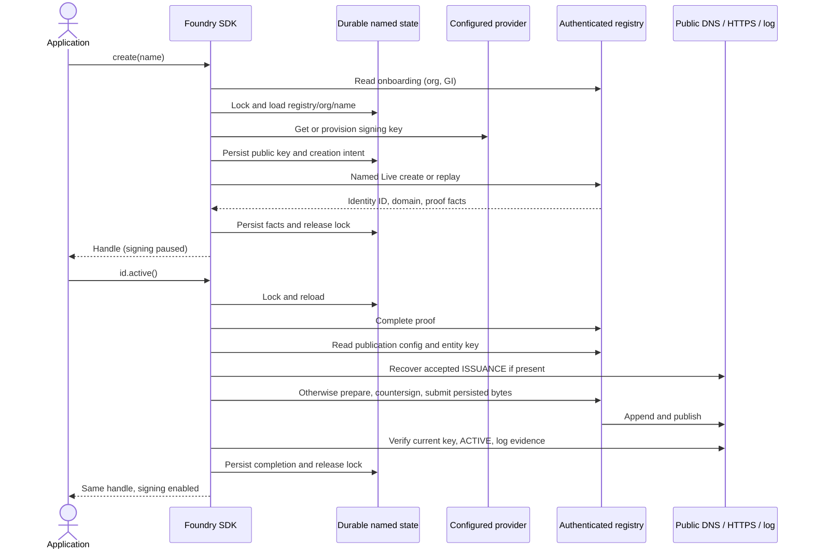

# Managed Registration Server Requirements

Server behavior that [Foundry create/active](sdk-design/13-managed-registration.md)
depends on. The server contract belongs to
[E2](https://github.com/Identity-Digital/known-foundry/issues/2) and its SCEN, SPEC,
and TEST artifacts. This document records what the SDK assumes and what is still
open. It is not a server specification and does not claim deployed support.

## Evidence and Ownership

Reviewed 2026-11-05:

| Source | Status |
|---|---|
| Server main `966e62eb` | Ordinary replay rows expire after 24 hours. Not enough for named recovery. |
| [PR #3150](https://github.com/Identity-Digital/dnsid/pull/3150) `6c01536a` | Open. Named Live ownership with a pending Agent row; exact, case-sensitive names; unique organization/name index. CANCELLED, REJECTED, and ERROR keep ownership; revoke, retire, and soft deletion release it. |
| [PR #3304](https://github.com/Identity-Digital/dnsid/pull/3304) `bd4a27a1` | Open. Caller-key Live: HTTP 202 replay, `request_id` equal to the caller's Idempotency-Key, 409 `KEY_MISMATCH` against the key pinned at create, replay-expiry tests. |
| [#45](https://github.com/Identity-Digital/known-foundry/issues/45)–[#48](https://github.com/Identity-Digital/known-foundry/issues/48) | Atomic assignment, durable workflow, create/status responses, integrated proof. |

E1 supplies domains, E2 owns admission and recovery, E4 owns credentials, E5 owns
the SDK and CLI, E6 owns key providers, E7 owns rotation, E8 owns terminal serving.
When the pool is empty, the server falls back to Live registration (E2 index); the
SDK does not choose a fallback.

## Workflow Overview

The server must continue accepted work without another client request, but it
cannot produce the customer countersignature. That step waits for the client.

## Existing Account Binding Discovery

The SDK uses `GET /api/v1/org/onboarding` for `org_id`, GI, and entity delegation
under [05](sdk-design/05-transport-and-registry.md#account-binding-discovery). The
entity key URL comes from `publication_config.ek_url`. No new endpoint is needed.
Server code accepts org API keys on this read; the spec and tests do not yet.

There is no capability field for named registration. Until E2/E5 agree a version
or capability negotiation, release against a tested server revision and record it.

## Required Server Work

Final E2 SCENs are the wire authority. Ordinary sandbox registration stays unchanged.

| ID | Required behavior | Status / gap |
|---|---|---|
| SR-1 | Authorize the organization; enforce verified-domain gates, tenant isolation, key validation, and quotas before effects. Do not expose other tenants' facts. | E2/E4, ABU-1. API-key authentication alone is not authorization. |
| SR-2 | Exact organization/name ownership, including pending rows. Matching concurrent requests return one identity. A different key fails without changing the identity or consuming a domain. | PR #3150. Further name policy needs server agreement. |
| SR-3 | Commit identity, domain reservation or pool assignment, and workflow handoff together. Paid registration waits for proof. Recover unfinished workflows without a client call. | #45, #46, #48. |
| SR-4 | Identity bindings outlive the replay cache. Delayed requests, cleanup, and terminal transitions never allocate a replacement or revive an old identity. | #45, #47, #48. |
| SR-5 | Preserve caller-key Live 202 and proof semantics, with `request_id` equal to the Idempotency-Key. **A replay with the same organization, name, and public key returns the identity ID, domain, and status**, so a replica without local state can resume. Reissue only expired proof on the same key. | PR #3304. Replay without a challenge can omit the domain today; this is a release gate. |
| SR-6 | Validate signatures before durably admitting submitted ISSUANCE bytes. An invalid signature does not consume the issuance key. Expose accepted-entry and preparation-reclaim facts. | #46. Different bytes under an accepted issuance key are rejected, not given its receipt. |
| SR-7 | Report registry progress, customer-action outcomes, structured errors, and publication fields (including `ek_url`). Readiness requires issuance, log inclusion, and publication. | #47. Wrong key is 409 `KEY_MISMATCH`. E2 #2 also lists `NAME_IN_USE`; confirm whether it stays, and when. |
| SR-8 | Replacement after revoke or retire gets a new domain and log stream; the old identity stays terminal. Delayed old creates do not trigger it. | Not agreed; see the [proposal](#proposal-name-reuse-and-failed-provisioning). Separate gate. |

## Decisions Still Owned Outside the SDK Design

- **E2 #45/#47:** Replacement intent, historical lookup, and the error matrix.
- **E2 #46:** Whether the Live proof challenge stays (ISSUANCE countersigning stays
  either way); which provisioning outcomes are recoverable or terminal. The 48-hour
  wait then ERROR is current behavior, not final policy.
- **E2 #47 / E5:** Compatibility negotiation.
- **Product / E2:** A Foundry-specific selector, only if Foundry and Live
  organizations need different rules in one deployment.
- **E2 / ABU-1:** Quota values, quota release, and failed-provisioning cleanup.
- **E4:** Credential scopes, expiry, renewal, and revocation.
- **E6:** Key provisioning, algorithms, multi-region setup, the one-identity-per-cloud
  model, and recovery of replicas that hold a different key.
- **E7 / E8:** Key and status hosting, rotation, terminal serving.

## Proposal: Name Reuse and Failed Provisioning

**Status:** Assumed by the SDK design; not yet agreed by E2. Record the agreed
outcome and SCEN links before enabling replacement.

Rules are per authenticated organization and exact name.

| Situation | Assumed server behavior |
|---|---|
| Provisioning fails or is unfinished | The name stays bound to the original attempt and key. A same-key retry resumes it. A different key gets `KEY_MISMATCH`. |
| Nonterminal identity; caller supplies the identity's current key after rotation | Return the existing identity, not `KEY_MISMATCH`. PR #3304 compares against the create-time key, so this needs agreement. |
| Nonterminal identity; caller supplies an unrelated key | `KEY_MISMATCH`; no change. |
| REVOKED or RETIRED; caller uses a key from that identity | Return the terminal identity. |
| REVOKED or RETIRED; caller supplies a new, unused key | Create a fresh identity and domain. No separate replacement API. |
| Delayed request with a key from an earlier identity | Resolve to that earlier identity, even after later replacements. |
| Replay cache expires or a row is soft-deleted | Neither permits replacement or revival. |

Example: A is created and retired; B replaces it and is retired. A delayed request
with A's key resolves to A. Competing replacement requests produce one new identity.

Open for E2: which failures can resume, how an attempt is abandoned, when a name or
domain is released, whether a new key is enough replacement intent, and how long
historical keys (including rotated keys) are retained for lookup.

## Acceptance Checks

Use real PostgreSQL and the shipped server, with Temporal and provider fixtures where
needed. Record server and SDK revisions.

- [ ] SR-1: tenant isolation, gates, and quotas hold independently of authentication;
  an org API key can read onboarding.
- [ ] SR-2/SR-3: concurrent matching creates yield one identity, domain, key, and
  handoff; conflicts change nothing.
- [ ] SR-3: interruption before or after commit recovers without a client call;
  completed work does not relaunch.
- [ ] SR-4: replay-cache expiry, restarts, lost responses, and deletion cause no
  reallocation or revival.
- [ ] SR-5: the SDK flow creates, replays, proves, and restarts; a replay without
  local state returns ID, domain, and status, then completes proof.
- [ ] SR-6: interrupted submissions reuse exact bytes; a competing
  signature is rejected and its replica recovers the accepted entry;
  invalid then valid submission succeeds.
- [ ] SR-7: all error and customer-action cases return structured outcomes; public
  `ACTIVE` is checked separately from `READY`.
- [ ] SR-8 (separate gate): replacement and late retries keep terminal history and
  allocate exactly one new domain.
- [ ] E5: Go, Python, TypeScript, and CLI pass the shared hosted scenarios.

Initial create needs SR-1 through SR-7 and refusal of terminal replacement. SR-8
enables replacement later.
