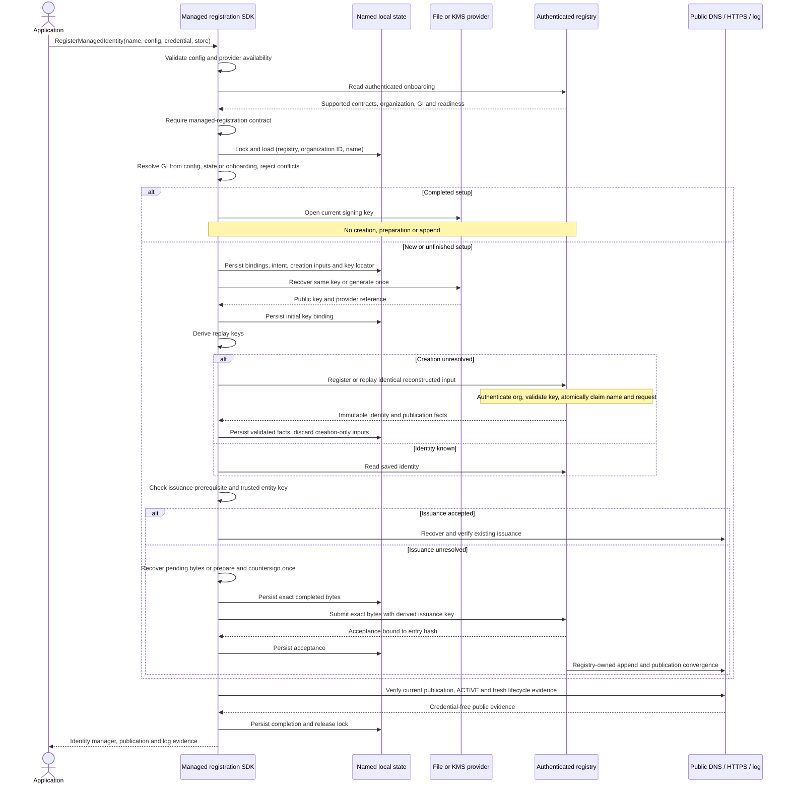

# Managed Registration Server Requirements

Outstanding server work for [managed setup](sdk-design/13-managed-registration.md)
and the [registry contract](sdk-design/05-transport-and-registry.md#named-managed-registration).
All SR items remain open until real persistence/integration tests pass. Observations
refer to `~/dnsid` revision `6ee74e05`, not deployed availability. The Known Foundry
PRD informs product requirements; its Working Notes are excluded.

## Workflow Overview

The SDK call blocks through public verification; it is not the PRD's separate
`create()` / `active()` API. This diagram shows intended behavior, not current coverage.

On timeout, the SDK retains progress and returns a resumable error. Unknown creation replays
identical input; unknown submission retries exact bytes. Replacement is a separate,
fresh-key operation after confirmed terminal state, not a timeout fallback.

## Existing Account Binding Discovery

`GET /api/v1/org` returns internal organization UUID `id`.
`GET /api/v1/org/onboarding` returns organization/GI and proof/delegation status;
[05](sdk-design/05-transport-and-registry.md#account-binding-discovery) defines validation.
It does not return a complete entity JWKS URL, so `entityKeyUrl` stays configured.
No new discovery endpoint is needed.

API-key middleware supplies organization-admin context before session checks,
allowing the admin-only onboarding read. Production assembly wires the service;
unconfigured onboarding returns 503. Source checks covered `server.go`,
`middleware.go`, `apikey_handlers.go`, `organization_handler.go`,
`org_onboarding_handler.go`, and `internal/serverapp/build.go`. These observations
are source checks, not live API-key admission or deployed capability validation.

## Required Server Work

| ID | Requirement | Observed gap / entry points |
|---|---|---|
| SR-1 | Validate authentication, authorization, derived key and input before allocation/claim. Use byte-exact onboarding organization ID and [canonical name rules](sdk-design/13-managed-registration.md#name-normalization); reject binding mismatch without disclosure under [05's error contract](sdk-design/05-transport-and-registry.md#named-managed-registration). | `AuthContext.OrgID` and onboarding bindings exist; `handleCreateAgent` accepts arbitrary keys and uses `TrimSpace` without NFC. |
| SR-2 | For keyed named managed requests, enforce one nonterminal identity per organization/name, including pending creation and recoverable `ERROR`; use [13's state set](sdk-design/13-managed-registration.md#registry-states). | Name is optional metadata; `Agent.Indexes` lacks organization/name uniqueness. Domain/key indexes already exclude the four terminal states. |
| SR-3 | Matching name/key/input opens the same identity; conflicts do not mutate/allocate. Authorized rotation preserves identity without another issuance. | `replayCreateAgent` opens by request key, not name; `CheckKeyUniqueness` may return conflict rather than open. |
| SR-4 | After validation, claim organization/name/key, request fingerprint, and identity atomically; one authoritative holder, no losing allocations, and no success without durable claims. Matching callers open the winner; different keys/input receive the documented conflict. | Agent creation precedes `idempotency.Store`; same-request-key losers are cancelled and some store failures only logged. Different keys derive different request keys, so replay uniqueness alone cannot protect names. |
| SR-5 | Permanent organization-scoped replay bindings/tombstones, including terminal/deleted identities. | `PGIdempotencyStore` uses a 24-hour TTL, reclaims/removes expired rows, and deletes some rollback claims. |
| SR-6 | After one of the four terminal states, require `replaces` equal to the current holder's immutable ID and a fresh key; atomically reassign name to new ID/domain/stream and preserve history. Reject previous initial/rotated keys; old replay takes precedence. `ERROR` cannot authorize replacement. | No named replacement mapping or intent field; active-key uniqueness does not enforce historical non-reuse. |
| SR-7 | Recover interrupted workflow handoff on the same identity; retain replay bindings through terminal cleanup. Recoverable `ERROR` retains its name until recovery or an authorized terminal transition. | Bounded handoff and orphan reconciliation exist; creation and replay claims are not committed together. |
| SR-8 | Validate all context and required signatures before permanently binding submitted bytes. Invalid countersignatures must not consume the issuance key. Matching replicas converge on one ISSUANCE; expose durable submission/reclaimability facts and accepted entry references for verified recovery. | `BeginPreparedEvent` validates before freezing admission bytes, but `handleSubmitTLogEvent` records rejected bytes/hash on validation errors. Preparation reservations, frozen-entry recovery and exact-byte reconciliation exist; named recovery must integrate them without a second append path. |
| SR-9 | Implement [key-specific endpoints](#key-specific-operational-endpoints-sr-9). | `jwksservice` serves active/retired keys together at the legacy URL; publication configuration still returns that URL. |
| SR-10 | Advertise `dnsid-managed-registration-v1` in authenticated onboarding's `managed_registration` array only when SR-1 through SR-9 and the named error contract pass acceptance checks. Absence never implies support. | `OrgOnboardingView` has no managed-registration capability field; current creation replay expires after 24 hours. |

### Key-Specific Operational Endpoints (SR-9)

Foundry serves `https://<agent-domain>/.well-known/<RFC7638-thumbprint>-jwks.json`:

- Permanently bind each URL to one public signing key; never redirect/rebind/reuse
  it or expose private material. Return the URL in publication configuration and
  publish it as entity-signed TXT `ku`.
- Rotation publishes the distinct new URL and updated entity-signed TXT through
  the existing coordinator. The current JWKS contains only the current key.
- Apply the [core retention rules](sdk-design/01-core-identity-manager.md#operational-key-rotation):
  retain the old URL/key through the previous TXT TTL plus a documented positive
  safety margin after authoritative replacement. Extend retention while rotation
  remains unresolved; return the retention deadline with rotation/publication facts.
- Origin/CDN cache lifetimes MUST NOT exceed the remaining retention interval.
  A cached old TXT can select its original key during this window. Retention does
  not authorize new signing with that key or replace lifecycle evidence. Signing
  resumes only after new publication and accepted rotation continuity are verified.
  Fresh verification follows signed current `ku`, never old-URL fallback.
- Revocation MUST retain the identity's terminal status and history. Retained public
  keys do not override revocation or authorize signatures after the terminal transition.

This is a product path/retention convention, not a DNSid protocol rule. SDKs consume
returned/signed URLs rather than construct them.

## Setup Credential Lifetime

Organization API keys support `expires_at`; setup should use an expiring key and
must not persist it in recovery state. A same-organization replacement credential
resumes the same operation. Expiration bounds duration, not organization-wide privileges.
Name-bound/create-only authorization remains deferred until credential scopes are available.

## Acceptance Checks

Use real PostgreSQL and shipped server assembly, including workflow handoff.
In-memory handler tests alone cannot establish atomic/permanent recovery.

- [ ] SR-1: API-key onboarding is tenant-isolated with accurate readiness status;
  wrong configured organization fails before identity, billing, or workflow writes.
- [ ] SR-2/SR-3: repeated/independent matching hosts open one identity; other tenants
  are isolated; different fresh keys racing for one name produce one holder and
  a conflict, not multiple identities or cancelled losing allocations.
- [ ] SR-4: concurrent creates produce one registration, no cancelled losers;
  claim-storage failure cannot return success.
- [ ] SR-5: restart, elapsed time beyond 24 hours, lost response, terminal state,
  and deletion never expire/reassign the original request key.
- [ ] SR-6: replacement has fresh ID/domain/stream and terminal old history;
  all four terminal states permit explicit replacement; `ERROR`, missing/stale
  `replaces`, and previous initial/rotated keys fail; delayed old requests cannot affect it.
- [ ] SR-7: interruption around claim commit/Temporal handoff resumes the original
  operation without orphan or duplicate allocation.
- [ ] SR-8: replicas with different valid countersignatures produce one ISSUANCE;
  accepted entry recovery converges them without another append or a wrong hash receipt.
- [ ] SR-8: invalid countersignature followed by a valid submission using the same
  issuance key succeeds; invalid input cannot freeze the request binding.
- [ ] SR-8: expired reclaimable preparation can be replaced under the same key;
  submitting/indeterminate/accepted state is not reclaimed. Restart and authorized
  rotation recover existing acceptance without another preparation/append.
- [ ] SR-9: creation/rotation return and publish distinct, valid-TLS URLs with one
  bound key each; updated TXT is entity-signed and log continuity verified.
- [ ] SR-9: interrupted rotation resumes the same operation/URLs; signing stays
  paused until publication and accepted evidence converge. Definitive append
  rejection after publication retains recovery state and returns failure with signing
  paused, without new-key activation or automatic publication rollback.
- [ ] SR-9: old URL serves only its bound key through the previous TXT TTL plus
  margin; retention extends for unresolved rotation and is returned to callers.
  Cache expiry stays within retention; no redirect, rebinding, unexplained current-key
  change, old-URL fallback, or acceptance that overrides revocation.
- [ ] SR-10: onboarding advertises the contract only after the complete acceptance
  set passes; absent/unsupported capability gates SDK mutations. Named failures have
  the documented status/code pairs without disclosing other tenants' identities.

## Other PRD Differences, Not Changed by Named Registration

These separate product requirements remain unresolved:

- Foundry requires verified customer-domain onboarding and customer-accountable GI/
  entity custody even on registry-operated domains; current sandbox behavior differs.
- Foundry allocates prepared dedicated `.io` domains; ordinary registration currently
  allocates root subdomains, while Live provisioning is a separate workflow.
- PRD `create()` / `active()` separates progress from completion; SDK setup still blocks
  through public verification.
